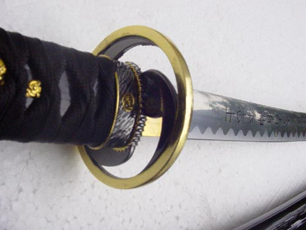

_Bushido_ (武士道) is a set of principles, a code of conduct and a way of life
of the _samurai_ (warrior) class in feudal Japan. _Bushido_ literally means "the
way of the warrior."

Contrary to what many tend to believe, _bushido_ isn't a written code. It's an
ethical legacy passed down by word of mouth or through the writings of
well-known warriors and scholars. Grasping everything that _bushido_ comprises
is difficult, and trying to confine it to a mere definition is inappropriate. To
understand _bushido_, think of strict, even stoic, self-discipline that puts
several values above everything else.

Those values can be summed up as:

> 君に忠、親に孝、自らを節すること厳しく、下位の者に仁慈を以てし、敵には憐みをかけ、私欲を忌み、公正を尊び、富貴よりも名誉を以て貴しとなす

くんにちゅう、おやにこう、みずからをせっすることきびしく、かいのものにじんじをもってし、てきにはあわれみをかけ、しよくをいみ、こうせいをたっとび、ふうきよりもめいよをもってたっとしとなす。

"Faithfulness to one's master, filial piety, relentless self-discipline,
benevolence towards one's subordinates, pity towards one's enemies, self-denial,
respect for justice, honor above all." (approximate translation)

Tracing _bushido_'s origins is no easy task. It wasn't the masterpiece of a
single person or the work of a group of scholars, but rather the essence of the
_samurai_ class. It unfolded gradually through the years of war since the 11th
century and came into full bloom in the first half of the 19th century.
