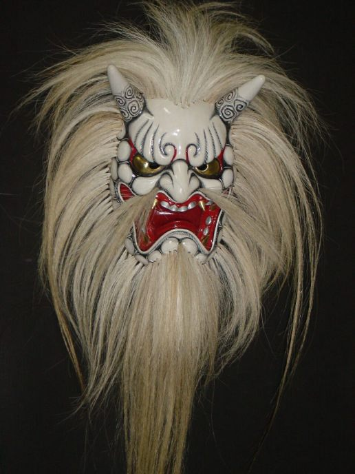

_Nō_ (能), also romanized as _Nou_ or _Noh_, is one of three main Japanese
traditional performing arts, along with _Kabuki_ and _Bunraku_. As the new
season of _Nō_ plays starts this month,
[Metropolis magazine](https://web.archive.org/web/20061119172043/http://www.metropolis.co.jp/tokyo/649/feature.asp)
has put up an informative article about this art, its roots and its
characteristics. Check the [Wikipedia entry](https://en.wikipedia.org/wiki/Noh)
for additional facts. For the uninitiated, this
[glossary of _Nō_ terms](https://web.archive.org/web/20061012050646/http://etext.lib.virginia.edu/japanese/noh/brazellgloss.html)
should be a great help. The same website also has several
[famous _Nō_ plays translated](https://web.archive.org/web/20060902214232/http://etext.lib.virginia.edu:80/japanese/noh/index.html),
with the original Japanese texts, viewable separately or on the same page using
frames.

There is another theatrical art form, often associated with _Nō_, called
[_Kyogen_](https://en.wikipedia.org/wiki/Kyogen). It serves as an intermission
between _Nō_ acts and is meant to make the audience laugh, with short comical
pieces spiced with satire and parody.
[This website](https://www2.ntj.jac.go.jp/unesco/noh/en/index.html) explains the
key differences between _Nō_ and _Kyogen_, and has some
[streamable videos](https://web.archive.org/web/20061107153124/http://www2.ntj.jac.go.jp/unesco/noh/en/movie.html)
as well.

Did you know that _Nō_ masks, called _Noumen_ (能面), change their expressions
depending on the angle of view?
[Check this out](https://www.kasrl.org/noh_mask.html) for an explanation of this
visual illusion! To explore the beauty of these masks further, this website has
an exhaustive [list of _Nō_ masks](https://nohmask21.com/eu/mlist.html), as well
as their [carving process](https://nohmask21.com/eu/process.html).
