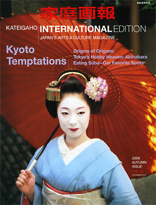

Geisha have long been one of the most distinctive aspects of traditional
Japanese culture, as well as one of the most stereotyped by foreigners,
alongside sushi! Their international popularity has grown even more thanks to
the unexpected success of _Memoirs of a Geisha_, both the
[novel by Arthur Golden](https://en.wikipedia.org/wiki/Memoirs_Of_A_Geisha) and
the
[Hollywood movie](https://en.wikipedia.org/wiki/Memoirs_of_a_Geisha_%28film%29)
(which I still haven't seen and probably never will, since it's just another
"glimpse of Japanese culture from an American standpoint").

As Mirai wrote on her blog today:

> Today, we can observe a dramatic decline in the number of Geisha. This is
> partly due to the decreasing demand. It may be possible that in several years
> it will be difficult to find any genuine Geisha in Japan. They would probably
> not be real traditional Geisha, but just pretend ones for tourists…

However, from a more optimistic point of view, things are going pretty well in
the geisha world these days. First, Internet ads have boosted the number of
_maiko_ in Kyoto. The MSN-Mainichi article states:

> Since it has become difficult for teahouses to find apprentice geisha who are
> descendants of geisha or who have connections with the area, more stores are
> advertising for apprentices online. As of the end of March the number of
> apprentice geisha in Kyoto stood at 75, the highest in 10 years.

Not only that, but geisha are now promoting their lifestyle through
[blogging](https://web.archive.org/web/20060826125637/http://hanaen.exblog.jp:80/)!
Of course, geisha can blog too! (もちろん、お芸者さんはブログも出来ますよ!)
[Ichi's blog](https://web.archive.org/web/20060903004059/http://ichi.dreamblog.jp:80/)
has had more than 220,000 visitors since it launched!

The picture above is the cover of the Autumn 2006 issue of
[Kateigaho International Edition](https://gahojapan.com/). According to
MSN-Mainichi, the decision to put a _maiko_ (or _geiko_, I'm confused) on the
cover wasn't an easy one.

> "No matter how deeply our readers are happy for us to delve into Japanese
> culture within the pages of the magazine, our research has shown that
> stereotypical images of Japan on the cover are still what most non-Japanese
> want to see," explains the editor-in-chief Takeshi Kudo.

But there's one thing I can't understand. I decided to write about geisha
yesterday, and today I noticed that Mirai had chosen the same topic. That made
me want to write about it even more. What shocked me was that Mari over at
Watashi To Tokyo had decided to write about the same topic… And Japundit too! It
may seem normal to some, since blogs usually have the same sources of
information, but I guarantee this isn't really news. Not to mention that I was
writing about it before reading any of those blogs. Is it Geisha Day or
something in Japan?
