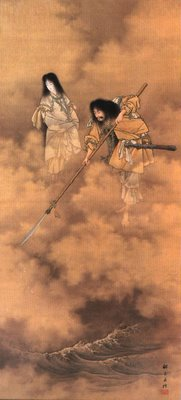

[Izanagi and Izanami](/blog/2006/09/shinwa-creation-of-the-universe/), the last
of the seven _kami_ generations (_Kami-noyo-nana-yo_ 神世七代), were commanded
by the Distinguishing Heaven _Kami_ (_Koto-amatsu-gami_ 別天津神) to “make,
consolidate, and give birth to this drifting land.” The two _kami_ were given a
jewelled halberd called _Ama-no-nuboko_ 天沼矛.

They stood on the bridge between heaven and earth, _Ame-no-ukihashi_ 天浮橋,
translated as “Floating Bridge of Heaven,” and churned the sea with the spear,
as illustrated in this artwork. They stirred until the brine became thick and
glutinous, then drew the _Ama-no-nuboko_ from it. The droplets that fell from
the spear's tip piled up and formed the first island, _Onogoro_ (_Onogoro-jima_
淤能碁呂島).

They descended and made a home on the island, building a pillar called
_Ame-no-mihashira_ 天御柱 and a palace called _Yahirodono_ 八尋殿, literally
“the hall eight arm lengths square.” Izanami called Izanagi to meet at the
pillar. Standing on opposite sides, Izanagi asked, “How has your body
developed?” (See the
[original quotes](https://ja.wikipedia.org/wiki/%E5%9B%BD%E7%94%A3%E3%81%BF)
from the [_Kojiki_](/blog/2006/06/japanese-mythology-origins/) in Japanese.)
Izanami replied, “My body has matured, but there is one part that hasn't.” Then
Izanagi said, “My body has matured too, but there is one part that has
overgrown. So let's join the part that hasn't matured in your body with the part
that has overgrown in mine to give birth.”

This was the first sexual intercourse in _Shinwa_, which resulted in the birth
of _Hiruko_ 蛭子. However, their first child was a failure and had no bones.
Their second child was _Awashima_ 淡島, literally “the pale island,” and was
also a failure. They put the children into a boat made of reeds and set them
adrift in a river, or the sea according to some other sources.

“The children to whom we have now given birth are not good. It will be best to
announce this in _Takama-no-hara_, the High Plain of Heaven,” said Izanagi and
Izanami. They went to the _Koto-amatsu-gami_ to ask why their offspring had
failed. The heavenly deities replied, “They were not good because the woman
spoke first. Descend again and amend your words.”

The two _kami_ did as they were told. Izanagi called Izanami to the pillar and
said, “Ah! What a fair and lovely maiden!” She answered immediately, “Ah! What a
fair and lovely youth!” From this union were born the _Ouyashima_ 大八洲, or the
land of the eight islands:

- _Awaji_ (_shima_) 淡路島
- _Iyo-no-futana_ (_no-shima_) 伊予之二名島 (later Shikoku)
- _Oki-no-mitsugo_ (_no-shima_) 隠伎之三子島
- _Tsukushi_ (_no-shima_) 筑紫島 (later Kyushu)
- _Iki_ (_no-shima_) 伊伎島
- _Tsushima_ 津島
- _Sado_ (_no-shima_) 佐度島
- _Oho-yamato-toyo-akitsu-shima_ 大倭豊秋津島 (later Honshu)

Note that Okinawa, Hokkaido, and Chishima weren't part of Japan in _Shinwa_.

## Glossary

- _Shinwa_: Japanese mythology
- _Kami_: Japanese god
- _Shima_: island

## Resources

- [Wikipedia](https://en.wikipedia.org/) (English and Japanese)
- [Fuushi's Network Japanese mythology page](https://web.archive.org/web/20060810040001/http://www.interq.or.jp:80/www-user/fuushi/b-eng/e-myth-1.htm)
- [The _Kojiki_ translation](https://web.archive.org/web/20060202110531/http://www.sacred-texts.com:80/shi/kj/kj009.htm)
