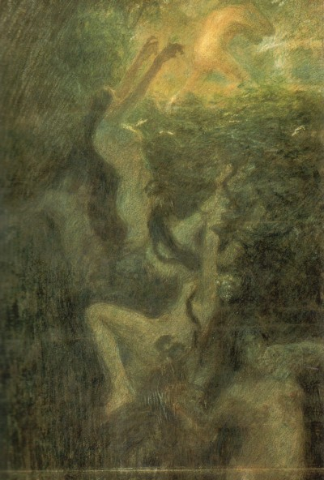

_Ameno-wo-habari_ 天之尾羽張 (also _Itsuno-wo-habari_ 都之尾羽張) was the name
of Izanagi's blood-stained saber after
[he cut down his son Kagutsushi](/blog/2006/09/shinwa-slaying-of-kagutsushi/),
who was responsible for the death of his mother, Izanami. The saber is usually
called _Totsuka-no-tsurugi_. Izanagi mourned his younger sister and decided to
head towards _Yomi_ 黄泉の国 (_Yomi-no-kuni_), the land of Hades, to bring her
back. _Yomi_ is believed to be the land where the dead are sent to rot forever.
Unlike _Takamanohara_, the high heavenly plain, _Yomi_ is an underground realm
with a geographical connection to the earth.

At _Yomi_'s entrance, believed to be in present-day
[Izumo Province](https://web.archive.org/web/20070621221523/http://upload.wikimedia.org/wikipedia/en/0/0b/Japan_prov_map_izumo.PNG),
Izanagi met Izanami. In the pitch darkness, he could only make out his sister's
blurry silhouette from outside. She came out from the depths of the filthy land
to meet him, and he said:

"My lovely younger sister! The lands that I and thou made are not yet finished
making; so come back!"

"Lamentable indeed that thou camest not sooner! I have eaten of the furnace of
Hades. Nevertheless, as I reverence the entry here of my lovely elder brother, I
wish to return with thee to the land of the living. Moreover I will discuss it
particularly with the _Yomutsu-kami_ 黄泉神, the deities of Hades. Look not at
me!" replied Izanami.

Those who taste the underworld's food can never leave. Izanami headed back to
the palace of the _Yomutsu-kami_ to consult with them about leaving _Yomi_,
insisting that Izanagi must not catch a glimpse of her. The truth was that she
was afraid of shocking her brother with her repugnant form.

Izanagi grew worried at his sister's delay. Impatient, he lit the outermost
tooth of the comb tucked into the left side of his long hair and headed into the
depths of _Yomi_ to find her. On his way, he witnessed the horrors of the
underworld. He was overwhelmed with dread when he caught up with Izanami and saw
her horrid, rotten body, with countless maggots swarming all over it. In each
rotten part of her body dwelt a _kami_:

- In her head, _Ohoi-kazuchi_ 大雷, the "Great Thunder"
- In her breasts, _Honoi-kazuchi_ 火雷, the "Fire Thunder"
- In her belly, _Kuroi-kazuchi_ 黒雷, the "Black Thunder"
- In her genitalia, _Sakii-kazuchi_ 折雷, the "Chance Thunder"
- In her left hand, _Wakai-kazuchi_ 若雷, the "Young Thunder"
- In her right hand, _Tsuchii-kazuchi_ 土雷, the "Land Thunder"
- In her left leg, _Narii-kazuchi_ 鳴雷, the "Rumbling Thunder"
- In her right leg, _Fushii-kazuchi_ 伏雷, the "Couchant Thunder"

Terrified, Izanagi fled. Izanami, angry at him for disobeying her, said, "Thou
hast put me to shame," then ordered _Yomotsushi-kome_ 黄泉醜女, the
"Ugly-Female-of-Hades," to chase after him. Izanagi tossed away his headgear and
made it turn into grapes in an attempt to delay her. He kept running while she
picked them and enjoyed their taste, a taste she was unlikely to come across in
_Yomi_. But she soon caught up with him. He broke off the outermost tooth of his
right comb and made it turn into bamboo shoots, then fled while she devoured
them.

Izanami saw that _Yomotsushi-kome_ was no match for Izanagi, so she sent the
eight thunder deities, along with 1,500 warriors of Hades, to catch him. He drew
his saber, _Totsuka-no-tsurugi_, and ran, brandishing it behind him. When he
reached the hills of _Yomotsu-hirasaka_ 黄泉比良坂, the "Even Pass of Hades," he
took three peaches from a tree and hurled them at the rushing hordes. Scared of
his might, they fled back to where they came from.

Izanagi thanked the peaches that had saved his life: "Like as ye have helped me,
so must ye help all living people when they shall fall into troublous
circumstances and be harassed!" He then called them _Ohoka-muzumi-nomikoto_
意富加牟豆美命, the "Great-Divine-Fruit."

Desperate, Izanami decided to pursue him herself. Izanagi rushed to the base of
the slope leading to _Yomi_, _Yomotsu-hirasaka_, and blocked the pass with a
huge boulder called _Chibiki-no-iwa_ 千引の岩. With each of them standing on one
side of the boulder, Izanami said:

"My lovely elder brother, if thou do like this, I will in one day strangle to
death a thousand of the folks of thy land."

Then Izanagi replied: "My lovely younger sister, if thou do this, I will in one
day set up a thousand and five hundred parturition-houses. In this manner each
day a thousand people would surely be born."

From then on, Izanagi was called _Yomotsu-ohokami_ 黄泉津大神, the
"Great-Deity-of-Hades." The rock blocking the path was called
_Chikaheshi-no-ohokami_ 道返之大神, the "Great-Deity-of-the-Road-Turning-Back,"
and the pass was called _Ifuya_ (伊賦夜坂 _Ifuyazaka_).

All quotes are taken directly from Hall Chamberlain's translation of the
_Kojiki_, with minor modifications.
