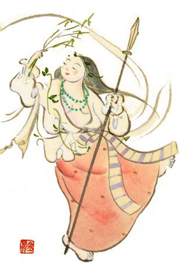

After [the birth of _Kagutsushi_](/blog/2006/09/shinwa-birth-of-gods/),
_Izanami_ suffered greatly and died from the pain. _Izanagi_ knelt at her feet
and wept: “Oh that I should have exchanged thee for this single child!” From his
tears was born _Nakisawame_ (_no-kami_) 泣沢女神, “Crying-Weeping-Female”.

Then _Izanagi_ buried her at Mount _Hiba_ 比婆の山 (_Hiba-no-yama_, in
present-day Shimane prefecture). Unable to control his anger, _Izanagi_ drew his
sword, _Totsuka-no-tsurugi_ 十拳剣, and cut down _Kagutsushi_. The sword
measured ten “grasps”, each grasp being the width of four fingers when
_Izanagi_'s hand was clenched. The blood that dripped from the point of the
_Totsuka_ gave birth to three deities:

- _Iwasaku_ (_no-kami_) 石折神, “Rock-Splitter”
- _Nesaku_ (_no-kami_) 根折神, “Root-Splitter”
- _Ihatsu-tsunowo_ (_no-kami_) 石筒之男神, “Rock-Possessing-Male”

Then, from the blood that stuck to the upper part of the blade, three other
deities were born:

- _Mika-hayabi_ (_no-kami_) 甕速日神, “Awfully-Swift-Deity”
- _Hi-hayabi_ (_no-kami_) 樋速日神, “Fire-Swift-Deity”
- _Takemi-kazushinowo_ (_no-kami_) 建御雷之男神, “Brave-Awful-Possessing-Male”,
  who is also called _Take-futsu_ (_no-kami_) 建布都神 or _Toyo-futsu_
  (_no-kami_) 豊布都神.

Two other deities were born from the blood that dripped from the hilt onto
_Izanagi_'s fingers: _Kurao-kami_ (_no-kami_) 闇淤加美神 and _Kura-mitsuha_
(_no-kami_) 闇御津羽神. From _Kagutsushi_'s body parts were born eight deities:

- From the head: _Masaka-yamatsumi_ (_no-kami_) 正鹿山津見神,
  “Possessor-of-the-True-Pass-Mountains”
- From the chest: _Odo-yamatsumi_ (_no-kami_) 淤縢山津見神,
  “Possessor-of-Descent-Mountains”
- From the belly: _Oku-yamatsumi_ (_no-kami_) 奥山津見神,
  “Possessor-of-the-Innermost-Mountains”
- From the genitalia: _Kura-yamatsumi_ (_no-kami_) 闇山津見神,
  “Possessor-of-the-Dark-Mountains”
- From the left hand: _Shigi-yamatsumi_ (_no-kami_) 志藝山津見神,
  “Possessor-of-the-Densely-Wooded-Mountain”
- From the right hand: _Ha-yamatsumi_ (_no-kami_) 羽山津見神,
  “Possessor-of-the-Outlying-Mountains”
- From the left leg: _Hara-yamatsumi_ (_no-kami_) 原山津見神,
  “Possessor-of-the-Moorland-Mountains”
- From the right leg: _To-yamatsumi_ (_no-kami_) 戸山津見神,
  “Possessor-of-the-Outer-Mountains”
