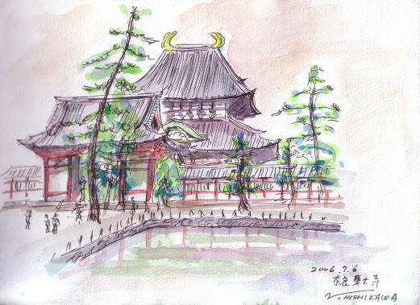

If going around the globe with your canvas and watercolours is your hobby, then
there is someone you can learn a lot from! Nishikawa-san is a Japanese artist
over 60 who tours the world with his “F-1 size sketch book and a set of water
paints in the pocket of his jacket”, as he stated on his English webpage.

Nishikawa-san's sketches are interesting in the way they picture the scenery at
a given moment from his very own point of view. Even though they are not as
detailed as a photograph, they are full of life. Taking a photo ends as soon as
the shutter is pressed, but sketching lets you enjoy and interact with the scene
for longer.

New York, England, Peru, France, China, and South Korea were just a few of the
many destinations depicted in Nishikawa-san's sketches. The website is in
Japanese, but there is an English page, so give
[Nishikawa-san's webpage](https://web.archive.org/web/20061208055838/http://www.eva.hi-ho.ne.jp/nishikawasan/)
a try if you like art. It is well worth browsing!
