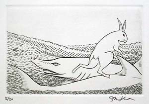

After marrying Princess _Kushinada_ and fathering several children, _Susanowo_
headed to _Yomi_, as he had planned since he was expelled to earth.

Time passed, and generations succeeded one another. Nothing notable happened
until a valiant descendant of _Susanowo_ and his many older brothers decided to
go on a long trip seeking Princess _Yagami_. _Oonamuji_ 大国主 and his eighty
older brothers left _Izumo_ for _Inaba_, where the beautiful princess lived.
Being the youngest, he was overpowered by his brothers and forced to carry their
luggage during the journey.

_Oonamuji_ grew tired and straggled behind his brothers. When he reached Cape
_Keta_, he found a badly wounded white hare. The creature's fur had been pulled
out, and its bruised, naked skin was exposed to the burning rays of the sun.
_Oonamuji_ drew nearer to examine the hare and ask what had happened: “Why liest
thou weeping?”

The worn-out creature explained that he had been on the island of _Oki_ (not too
far from _Izumo_ and _Inaba_) and had no way to cross the sea to reach the
mainland, so he had thought of a deceitful scheme. He called out to a shark
(“crocodile of the sea” in Hall Chamberlain's translation) and challenged him,
claiming there were more hares than sharks. The white hare asked the shark to
summon all his friends so that he could count them and prove that his own
community was larger. Tempted, the shark called all his companions, who swam on
the surface alongside each other. The hare jumped on their backs as if he were
counting them. But his real purpose was to cross the sea on the bridge made by
the sharks.

However, he couldn't control his excitement and, as he jumped over the last
shark, said, “You have been deceived by me!” The sharks were furious when he
revealed his real intentions and attacked him violently. He then lay on the
ground for hours until he was discovered by the eighty brothers who were ahead
of _Oonamuji_. He told them his story and asked for advice. “Bathe in the salt
water, and lie down exposed to the wind under the sun,” they proposed. He
followed their words, only to end up in a deplorable state as the salt dried on
his wounds.

“Go quickly now to the river, wash thy body with the fresh water, then take the
pollen of the sedges growing at the river-mouth, spread it about, and roll about
upon it, then hide in the shade; whereupon thy body will certainly be restored
to its original state,” instructed _Oonamuji_.

The white hare of _Inaba_ did as he was told, and his body was restored to its
original state. The creature promised _Oonamuji_ that the princess would choose
him for his gentle heart.
