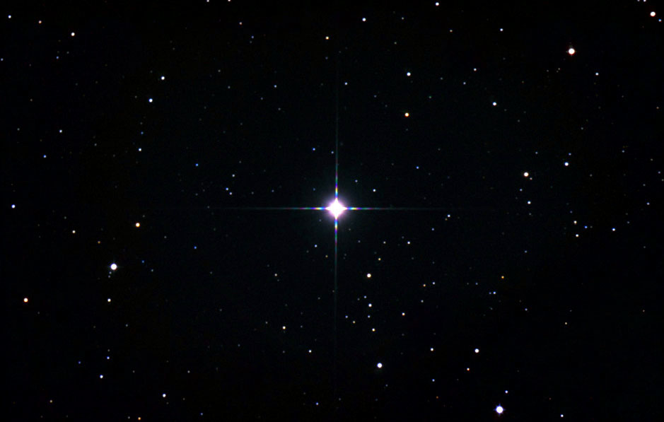

I wrote a brief introduction to Japanese mythology in two previous posts, where
I introduced its two main sources, the
[_Kojiki_](/neosamurai/2006/06/japanese-mythology-origins/) and the
[_Nihonshoki_](/neosamurai/2006/06/the-nihonshoki/).

_Shinwa_ started long before the lands of Japan were created, with several
deities appearing at the creation of the universe (天地開闢 _Tenchikai Byaku_)
on _Takama-no-hara_ (高天原), translated as “The High Plain of Heaven”. The
first three were called the Three _Kami_ of the Universe (造化の三神
_Zouka-no-sankami_):

- _Ameno-Minakanushi_ (_no-kami_) 天之御中主神 can be translated as
  Master-of-the-August-Centre-of-Heaven, associated with the North Star today.
- _Takami-Musubi_ (_no-kami_) 高御産巣日神 means High-August-Producing-_Kami_.
- _Kami-Musubi_ (_no-kami_) 神産巣日神 means Divine-Producing-Wondrous-Deity.

These three deities disappeared with the creation of heaven and earth. The next
two _Kami_, _Umashi-ashikabi-hikoji_ (_no-kami_) 宇摩志阿斯訶備比古遅神 and
_Ameno-tokotachi_ (_no-kami_) 天之常立神, meaning
Pleasant-Reed-Shoot-Prince-Elder and Heavenly-Eternally-Standing-Deity
respectively, were born from a jellyfish-like thing floating on the sea.

The five _Kami_ mentioned above are called _Koto-amatsu-gami_ (別天津神),
“Distinguishing Heavenly _Kami_”. They were born alone and hid themselves. After
the _Koto-amatsu-gami_ came the _Kami-noyo-nana-yo_ (神世七代), which can be
translated as “the seven _Kami_ generations”. The last five generations each
have a _Kami_ and a _Megami_:

- _Kunino-tokotachi_ (_no-kami_) 国之常立神: Earthly-Eternally-Standing-Deity.
- _Toyokuninushi_ (_no-kami_) 豊雲野神: Luxuriant-Integrating-Master.
- _Uiji_ (_no-kami_) 宇比邇神: Mud-Earth-Lord · _Suiji_ (_no-kami_) 須比智邇神:
  Mud-Earth-Lady.
- _Tsumegui_ (_no-kami_) 角杙神: Germ-Integrating-Deity · _Ikugui_
  (_no-kami_) 活杙神: Life-Integrating-Deity.
- _Ooto-noji_ (_no-kami_) 意富斗能地神: Elder-of-the-Great-Place · _Ooto-nobe_
  (_no-kami_) 大斗乃弁神: Elder-Lady-of-the-Great-Place.
- _Omodaru_ (_no-kami_) 淤母陀琉神: Perfect-Exterior · _Ayakashi-kone_
  (_no-kami_) 阿夜訶志古泥神: Oh-Awful-Lady.
- _Izanagi_ (_no-kami_) 伊邪那岐神: Male-who-Invites · _Izanami_
  (_no-kami_) 伊邪那美神: Female-who-Invites.

Note that in each of the last five generations, the _Kami_ and _Megami_ are an
older brother and a younger sister (_Kyoudai_ 兄妹).

## Glossary

- _Shinwa_: Japanese mythology
- _Kami_: Japanese god
- _Megami_: Japanese goddess

## Resources

- [Wikipedia](https://en.wikipedia.org/) (English and Japanese)
- [Fuushi’s Network Japanese mythology page](https://web.archive.org/web/20060810040001/http://www.interq.or.jp:80/www-user/fuushi/b-eng/e-myth-1.htm)
- [The _Kojiki_ translation](https://web.archive.org/web/20060202110531/http://www.sacred-texts.com:80/shi/kj/kj009.htm)
