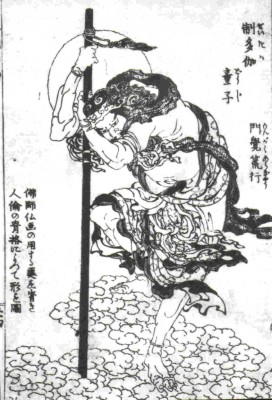

_Izanagi_ fled [_Yomi_](/neosamurai/2006/09/shinwa-realm-of-hades/), leaving
behind the goddess of Hades, his sister _Izanami_. In _Shinwa_, as in many
mythologies, the land of Hades is seen as a dirty place. So Izanagi decided to
purify himself after leaving it: “Nay! hideous! I have come to a hideous and
polluted land, so I will perform the purification of my person.”

He then headed to _Awakihara_ 阿波岐原, the “valley of
[Japanese clovers](https://en.wikipedia.org/wiki/Bush_clover),” and cleansed
himself in a river. As in the previous events, _Kami_ are often born from every
action of Izanami and Izanagi, which is what makes _Shinwa_ a mythology of over
8,000 gods. This time, Izanagi's undressing gave birth to twelve deities, each
associated with an item he took off or put aside.

- From his staff, _Tsukitatsu-funato_ (_no-kami_) 衝立船戸神. There is no clear
  translation, but it loosely means “Thrust-Stand-Come-No-Further.”
- From his [_obi_](<https://en.wikipedia.org/wiki/Obi_(sash)>),
  _Michino-nagachiha_ (_no-kami_) 道之長乳歯神, “Road-Long-Space.”
- From his bag, _Tokiha-kashi_ (_no-kami_) 時量師神, “Loosen-Put.”
- From his clothes, _Wazurahi-noushi_ (_no-kami_) 和豆良比能宇斯能神,
  “Master-of-Trouble.”
- From his [_hakama_](https://en.wikipedia.org/wiki/Hakama), _Michimata_
  (_no-kami_) 道俣神, “Road-Fork-Deity.”
- From his crown, _Akigu-hinoushi_ (_no-kami_) 飽咋之宇斯能神,
  “Master-of-the-Open-Mouth.”
- From his left bracelet:
  - _Oki-zakaru_ (_no-kami_) 奥疎神, “Shore-Distant.”
  - _Okutsu-nagisabiko_ (_no-kami_) 奥津那芸佐毘古神,
    “Wash-Prince-of-the-Shore.”
  - _Okitsuka-hibera_ (_no-kami_) 奥津甲斐弁羅神,
    “Intermediate-Direction-of-the-Shore.”
- From his right bracelet:
  - _Hezakaru_ (_no-kami_) 辺疎神, “Offing-Distant.”
  - _Hetsunagi-sabiko_ (_no-kami_) 辺津那芸佐毘古神,
    “Wash-Prince-of-the-Offing.”
  - _Hetsuka-hibera_ (_no-kami_) 辺津甲斐弁羅神,
    “Intermediate-Direction-of-the-Offing.”

Izanagi plunged into the middle of the river, thinking that the water upstream
was too rapid and the water downstream too sluggish. Two _Kami_ were born from
the filth he washed off in the river: _Yasoma-gatsuhi_
(_no-kami_) 八十禍津日神 and _Ohoma-gatsuhi_ (_no-kami_) 大禍津日神,
respectively “Wondrous-Deity-of-Eighty-Evils” and
“Wondrous-Deity-of-Great-Evils.” To cleanse the evil caused by these two _Kami_,
three other _Kami_ were born:

- _Kamu-naobi_ (_no-kami_) 神直毘神, “Divine-Rectifying-Wondrous.”
- _Oho-naobi_ (_no-kami_) 大直毘神, “Great-Rectifying-Wondrous.”
- _Izunome_ 伊豆能売, “Female-Deity-Idzu.”

Next, more _Kami_ were born at each level of the water. As Izanagi bathed at the
bottom, two deities were born:

- _Sokotsu-watatsumi_ (_no-kami_) 底津綿津見神, “Possessor-of-the-Ocean-Bottom.”
- _Sokotsu-tsunowo_ (_no-kami_) 底筒之男神, “Elder-Male-of-the-Bottom.”

When he bathed in the middle of the water:

- _Nakatsu-watatsumi_ (_no-kami_) 中津綿津見神, “Possessor-of-the-Ocean-Middle.”
- _Nakatsu-tsunowo_ (_no-kami_) 中筒之男神, “Elder-Male-of-the-Middle.”

When he bathed at the surface:

- _Uhatsu-watatsumi_ (_no-kami_) 上津綿津見神, “Possessor-of-the-Ocean-Surface.”
- _Uhatsu-tsunowo_ (_no-kami_) 上筒之男神, “Elder-Male-of-the-Surface.”

When Izanagi washed his left eye, the _Megami Amaterasu-ohomi_
(_kami_) 天照大御神 (“Heaven-Shining-Great-August-Deity”) was born. When he
washed his right eye, the _Kami Tsukiyomi-no-mikoto_ 月読命 (“Moon-Night
Possessor”) was born. And finally, _Takehaya-susanowo-nomikoto_
建速須佐之男命 (“Brave-Swift-Impetuous-Male-Augustness”) was born when Izanagi
washed his nose.

Those last three deities, commonly known as _Amaterasu_, the incarnation of the
sun, _Tsukiyomi_, the incarnation of the moon, and _Susanowo_, the incarnation
of wind or storm, are the most important and will be the focus of the next
_Shinwa_ entry.
