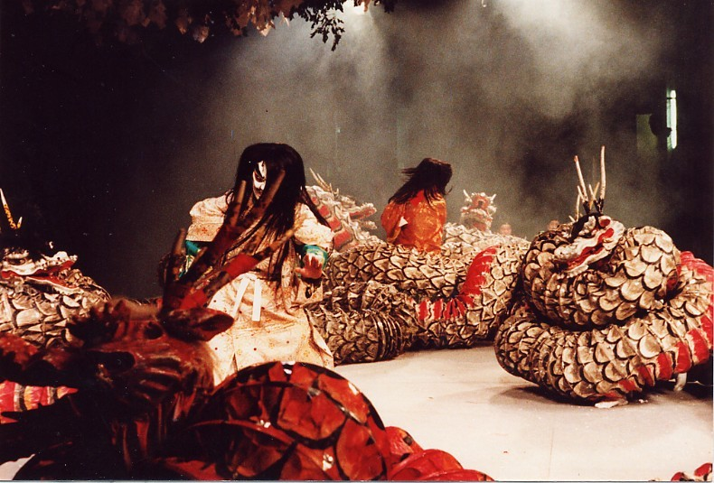

After he was
[expelled from _Takamanohara_](/neosamurai/2006/10/shinwa-the-missing-sun/),
_Susanowo_ descended to earth and headed to the _Hii_ river (斐伊) in
[Izumo province](https://web.archive.org/web/20070621221523/http://upload.wikimedia.org/wikipedia/en/0/0b/Japan_prov_map_izumo.PNG).
While strolling along the river, he spotted a chopstick drifting with the
current and deduced that someone must be living in the hills up ahead. He kept
going until he met an old couple and a charming young woman. They were weeping
nonstop. Curious, _Susanowo_ asked why they were mourning. The old man explained
that every year, an eight-headed serpent called _Yamata-no-Orochi_ (八岐の大蛇)
came and took one of his eight daughters. It was almost time for the beast to
come and claim the last one.

"I had originally eight young girls as daughters. But the eight-forked serpent
of Koshi has come every year and devoured one, and it is now its time to come,
wherefore we weep. Its eyes are like _akakagachi_; it has one body with eight
heads and eight tails. Moreover, on its body grows moss. Its length extends over
eight valleys and eight hills, and if one looks at its belly, it is all
constantly bloody and inflamed," said the old man, _Ashi-Nazuchi_.

Hearing this, _Susanowo_ proposed that he marry their daughter,
_Kushinada-hime_, if he defeated _Orochi_ and saved her life. Knowing that he
had come from heaven, _Ashi-Nazuchi_ and _Te-Nazuchi_ couldn't help but accept
his deal. _Susanowo_ asked them to build a fence around the house with eight
gates, each holding a barrel of _sake_. He turned the young woman into a comb
and hid her in his hair.

After a while, the eight-headed snake-dragon came to take _Kushinada-hime_.
However, even the almighty _Orochi_ couldn't resist the _sake_ before him and
started drinking, each head from its own barrel. After drinking, he fell asleep,
giving _Susanowo_ the perfect chance to wield the _Totsuka-no-Tsurugi_ and cut
off _Orochi_'s heads one by one, as well as his tails. When he slashed the last
tail, his sword hit another metallic object with a shrill clang. He carefully
cut the tail open and found a sword called _Ame-no-Murakamo-no-Tsurugi_
(天叢雲剣), which he later handed to his sister _Amaterasu_.

## Sidenotes

- Izumo is in present-day Shimane prefecture.
- Koshi is a district in the province of Echigo, today's Niigata prefecture.
- "Eight" in mythological texts means "numerous," not necessarily eight. The
  same goes for the number of gods who gathered in front of the cave to bring
  out _Amaterasu_: some versions say 80, some 800, and some use the more correct
  term "myriads." But for the sake of simplicity, we'll consider it eight heads
  and tails.
- _Ame-no-Murakamo-no-Tsurugi_ was later called _Kusanagi_.

Moral: never, ever drink _sake_ before picking a fight!
