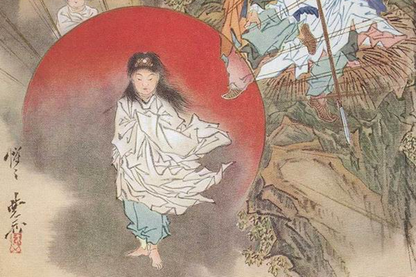

After _Izanagi_
[bore the three children](/neosamurai/2006/09/shinwa-purification-of-izanagi/),
_Amaterasu_, _Susanowo_, and _Tsukiyomi_, he rejoiced and said: “I, begetting
child after child, have at my final begetting gotten three illustrious
children.” He then ordered _Amaterasu_ to rule over _Takamanohara_, or the High
Plain of Heaven (in some translations, she was ordered to rule over the day),
_Tsukiyomi_ to rule over the night, and _Susanowo_ to rule over the sea. The
first two fulfilled their roles, but _Susanowo_ did nothing but weep and lament.
He sobbed until the rivers and seas dried up, and the green mountains withered
and grew dim. _Izanagi_ approached him and asked: “How is it that, instead of
ruling the land with which I charged thee, thou dost wail and weep?”

“I wail because I wish to depart to my deceased mother’s land, to the Nether
Distant Land,” _Susanowo_ replied.

_Izanagi_, angered, scolded his son: “If that be so, thou shalt not dwell in
this land,” and expelled him.

There are different versions of what became of _Izanagi_ after he accomplished
his divine tasks. In the _Kojiki_, it is said that he lived as a hermit at
_Taga_ in _Afumi_
([_Omi_ province](https://web.archive.org/web/20050914200821/http://upload.wikimedia.org:80/wikipedia/en/6/6e/Japan_prov_map_omi.PNG)),
whereas in the _Nihongi_, he reported back to the heavenly deities about his
accomplishments and settled there forever.

_Susanowo_ replied obediently: “If that be so, I will bid adieu to _Amaterasu_
and depart.” He then ascended to the heavens, where his older sister dwelt. His
boisterous nature caused turmoil in the seas and made the mountains groan on his
way up to heaven. Hearing the noise of his approach, she doubted his intent and
readied herself for the worst. She untied her hair and wove it into two strands,
then adorned her head and wrists with 500 _Yasaka_ jewels. She carried two
quivers on her back, one holding 1,000 arrows and the other 500. She put on an
arm pad, brandished her bow, and firmly grasped the hilt of her sword, standing
valiantly like a fierce warrior.

When _Susanowo_ reached her, she said: “Wherefore ascendest thou hither?” Her
brother replied right away: “I have no evil intent. It is only that when our
father spoke, deigning to enquire the cause of my wailing and weeping, I said,
‘I wail because I wish to go to my deceased mother’s land,’ and our father
replied, ‘Thou shalt not dwell in this land,’ and deigned to expel me with a
divine expulsion. It is therefore solely with the thought of taking leave of
thee and departing that I have ascended hither. I have no strange intentions.”

“If that be so, whereby shall I know the sincerity of thine intentions?”
enquired _Amaterasu_.

“Let each of us swear and produce children. If the children which I produce are
females, then it may be taken that I have an impure heart. But if the children
are males, then it must be considered that my heart is pure.”

Thus, they stood on opposite sides of the Tranquil River of Heaven,
_Ameno-yasukaha_ (the Milky Way). _Amaterasu_ asked _Susanowo_ to hand her his
saber, _Totsuka-no-tsurugi_, and broke it into three fragments. She washed the
fragments in the _Ameno-manawi_, the True Well of Heaven. After chewing them
with a crunching noise, she spat them out, giving birth to three _Megami_
(female _Kami_) from her breath:

- _Takiribime_ 多紀理毘売命, the “Torrent Mist Princess”
- _Ichikishima-hime_ 市寸島比売命, “Princess of the Island of the Offing”
- _Takitsuhime_ 多岐都比売命, “Lovely Island Princess”

Next came _Susanowo_’s turn. He asked his sister to hand him the 500 _Yasaka_
jewels woven into her hair and wound around her wrists. He then washed them in
the True Well of Heaven, crunched them, and blew them out, giving birth to five
_Kami_:

- From the jewels in the left bunch of her hair,
  _Masakatsu-akatsu-kachihayabi-ameno-oshiomimi_ 正勝吾勝勝速日天之忍穂耳命,
  “Truly Conquering Swift Heavenly Great Ears”
- From the jewels in the right bunch of her hair, _Amenohohi_ 天之菩卑能命
- From the jewels of her headdress, _Amashi-hikone_ 天津日子根命, “Prince Lord
  of Heaven”
- From the jewels on her left wrist, _Ikushihi-kone_ 活津日子根命, “Prince Lord
  of Life”
- From the jewels on her right wrist, _Kuma-no-kusubi_ 熊野久須毘命

Then _Amaterasu_ declared: “As for the seed of the five male Deities born last,
their birth was from things of mine; so undoubtedly they are my children. As for
the seed of the three female Deities born first, their birth was from a thing of
thine; so doubtless they are thy children.”
